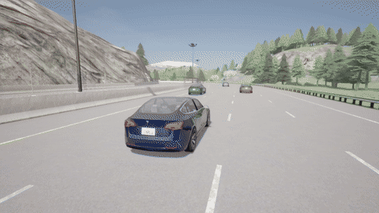

# DriveWeave

CARLA + SUMO 自动驾驶软件仿真与传感器工具链。

基于 CARLA 官方 Town03、Town04、Town05、Town06 地图定制交通场景、车辆交互和传感器配置；当前未自建道路几何、建筑或地形。

[GitHub 源代码](https://github.com/Ekko82/DriveWeave) · [已发布版本](https://github.com/Ekko82/DriveWeave/releases)

使用 **CARLA 0.9.16 内置 Tesla Model 3**、原生车辆物理、相机和激光雷达录制道路场景，并用 CPU 处理真实传感器数据。主车使用公开规则、原生 waypoint 和 VehicleControl；背景交通使用 TrafficManager 或明确配置的场景控制。项目包含官方 CARLA/SUMO 双向实时协同与录制后 SUMO-GUI 同步回放两条流程。

项目用于仿真演示、接口复现和数据核验。没有训练或加载自动驾驶/目标检测模型，没有运行 LimSim。语义与实例掩码是仿真真值；点云来自原生 LiDAR 返回。处理结果没有回传为视觉感知驾驶闭环。

## v3 交通交互与综合视频

[观看综合视频](https://github.com/Ekko82/DriveWeave/releases/download/v3.0.0/DriveWeave-traffic-and-sensors.mp4) · [v3 完整素材](https://github.com/Ekko82/DriveWeave/releases/tag/v3.0.0) · [运行方法](docs/traffic-v3.md) · [验收摘要](docs/media/accepted-v3-summary.json)

这一版增加前车、后车和邻道交通，录制了真实后视相机。高速场景包含慢车跟随、邻道后车接近、等待间隙及换道；匝道包含合流和驶出；路口与环岛包含对向或环内车流、停车让行及继续驶出。车辆采用 CARLA 原生物理，交通角色由公开规则配置。



上图取自新高速录像的第 12–18 秒，按 10 fps 展示，仍为六秒原速。[预览来源](docs/media/preview-v3.json)

| 新录制场景 | 原始帧数 | 完整时长 | 跟车画面 | 相机与处理四视图 |
| --- | ---: | ---: | --- | --- |
| 高速换道 | 827 | 41.35 秒 | [MP4](https://github.com/Ekko82/DriveWeave/releases/download/v3.0.0/DriveWeave-highway-chase.mp4) | [MP4](https://github.com/Ekko82/DriveWeave/releases/download/v3.0.0/DriveWeave-highway-sensors.mp4) |
| 匝道驶入 | 722 | 36.10 秒 | [MP4](https://github.com/Ekko82/DriveWeave/releases/download/v3.0.0/DriveWeave-ramp-entry-chase.mp4) | [MP4](https://github.com/Ekko82/DriveWeave/releases/download/v3.0.0/DriveWeave-ramp-entry-sensors.mp4) |
| 匝道驶出 | 705 | 35.25 秒 | [MP4](https://github.com/Ekko82/DriveWeave/releases/download/v3.0.0/DriveWeave-ramp-exit-chase.mp4) | [MP4](https://github.com/Ekko82/DriveWeave/releases/download/v3.0.0/DriveWeave-ramp-exit-sensors.mp4) |
| 无保护左转 | 675 | 33.75 秒 | [MP4](https://github.com/Ekko82/DriveWeave/releases/download/v3.0.0/DriveWeave-left-turn-chase.mp4) | [MP4](https://github.com/Ekko82/DriveWeave/releases/download/v3.0.0/DriveWeave-left-turn-sensors.mp4) |
| 环岛驶入驶出 | 972 | 48.60 秒 | [MP4](https://github.com/Ekko82/DriveWeave/releases/download/v3.0.0/DriveWeave-roundabout-chase.mp4) | [MP4](https://github.com/Ekko82/DriveWeave/releases/download/v3.0.0/DriveWeave-roundabout-sensors.mp4) |

完整场景按原速 20 fps 保留全部源帧；综合视频剪辑场景和机位，保持原速，不加画面文字或插值。新四视图为跟车、前视、图像处理和点云处理。综合片末尾引用 v2 的官方 CARLA/SUMO 协同录制，SUMO 窗口仍是录制后同步回放；本轮五个新场景尚未接入实时协同录制器。

高速录像实际等待约 6.9 秒后换道，整个换道过程的动态间距通过检查。左转在六辆对向车全部通过后进入路口。环岛原先较宽的入口区域检查仍有一项 FAIL；按真实行驶车道与车身扫掠区域复核，实际交叉冲突区域没有同时占用，两个报告均保留。左转及环岛驶出尾段没有持续近距离后车，人工画面审阅也只是抽样；详细范围见验收摘要。

## v2 历史录像与 GIF 预览

以下六条为 v2 录像及其原有验证记录。全部原速 20 fps，不裁剪完整源帧、不插值，不添加标题或 HUD。

[已验证 GitHub Release](https://github.com/Ekko82/DriveWeave/releases/tag/v2.0.0)；公开源代码版本 `daf31c832e14b6eba5fcd96c93777dad01aa73cb`。下方 GIF 是对应完整视频中连续六秒的真实解码画面，以 10 fps 展示，播放时长仍为六秒。

| 场景 | 实际源帧 | 完整时长 | 高清视频 |
| --- | ---: | ---: | --- |
| 高速换道 | 334 | 16.7 秒 | [MP4](https://github.com/Ekko82/DriveWeave/releases/download/v2.0.0/highway-carla-sumo-four-pane.mp4) |
| 匝道驶入 | 487 | 24.35 秒 | [MP4](https://github.com/Ekko82/DriveWeave/releases/download/v2.0.0/ramp-entry-carla-sumo-four-pane.mp4) |
| 匝道驶出 | 476 | 23.8 秒 | [MP4](https://github.com/Ekko82/DriveWeave/releases/download/v2.0.0/ramp-exit-carla-sumo-four-pane.mp4) |
| 宽路口无保护左转 | 580 | 29 秒 | [MP4](https://github.com/Ekko82/DriveWeave/releases/download/v2.0.0/left-turn-carla-sumo-four-pane.mp4) |
| 环岛驶入驶出 | 1001 | 50.05 秒 | [MP4](https://github.com/Ekko82/DriveWeave/releases/download/v2.0.0/roundabout-carla-sumo-four-pane.mp4) |
| 官方双向实时协同 | 334 | 16.7 秒 | [MP4](https://github.com/Ekko82/DriveWeave/releases/download/v2.0.0/live-highway-carla-sumo-four-pane.mp4) |

五条普通场景源于 CARLA 原生物理录制；live-highway 源录制另有实际官方双向协同与 SUMO 自主车辆运动证据。**六片右上角均为录制后的原生 SUMO GUI 同步回放**，不能把展示回放称为重新运行的实时控制。图像框来自仿真真值，点云来自原生 LiDAR 处理；没有训练检测或驾驶模型。

左转 SUMO 回放有一处明确的表示限制：后台车辆在相连道路端点附近的一个样本（501，原生帧 1200430）返回空车道字段，距端点约 5.8 厘米；整辆车位于实际原生 GUI 视口外。原严格全车道审计 FAIL 仍保留，未补写车道或改动姿态。主车全部车道字段及全部源姿态、时间、截图已核验；不能声称所有车辆所有样本车道归属均通过。

环岛 SUMO 回放保留 16 个原始空车道字段：主车在相连道路端点处的两个单帧（157、473，距端点均小于 0.1 米，原生截图主车仍可见），以及一个后台车辆在转换路网 road44/-5 上连续 14 帧（41–54，整车位于实际视口外）。全部源位置、朝向、时间及原始截图 SHA 已核验，但全车辆/全主车样本的车道归属均不能声称通过；原 strict FAIL 保留，未补字段或移动车辆。独立 GUI 重现的少量栅格差异单独实测，原截图始终不变；此片展示的是录制后同步回放。

### 高速换道


[完整原速视频](https://github.com/Ekko82/DriveWeave/releases/download/v2.0.0/highway-carla-sumo-four-pane.mp4)

### 匝道驶入


[完整原速视频](https://github.com/Ekko82/DriveWeave/releases/download/v2.0.0/ramp-entry-carla-sumo-four-pane.mp4)

### 匝道驶出


[完整原速视频](https://github.com/Ekko82/DriveWeave/releases/download/v2.0.0/ramp-exit-carla-sumo-four-pane.mp4)

### 宽路口无保护左转


[完整原速视频](https://github.com/Ekko82/DriveWeave/releases/download/v2.0.0/left-turn-carla-sumo-four-pane.mp4)

### 环岛驶入驶出


[完整原速视频](https://github.com/Ekko82/DriveWeave/releases/download/v2.0.0/roundabout-carla-sumo-four-pane.mp4)

### 官方双向实时协同


[完整原速视频](https://github.com/Ekko82/DriveWeave/releases/download/v2.0.0/live-highway-carla-sumo-four-pane.mp4)

帧数、SHA-256、源采集与展示范围见 [公开验收摘要](docs/media/accepted-v2-summary.json) 和 [预览索引](docs/media/preview-index.json)。人工审阅范围在摘要中逐片披露，不冒充全片人工观看。

## 两种 SUMO 流程

| 流程 | 谁产生车辆运动 | SUMO 画面与证据 |
| --- | --- | --- |
| 官方实时双向协同 | CARLA 车辆保留物理控制；独立 SUMO 车辆由 SUMO 跟车/换道逻辑驱动，在 CARLA 中由官方桥接器创建关闭物理的运动镜像 | capture_live_cosim.py 调用官方 SimulationSynchronization.tick()；保存每步双向 actor ID、位姿、速度、网络及执行证据。展示面板在录制后生成，明确标为同步回放 |
| 录制后同步回放 | 已完成 CARLA 录制中的实际车辆位姿 | sumo_sync_replay.py 按官方 BridgeHelper 转换，经 TraCI moveToXY 将同源帧位姿写入真实 SUMO，录原生 GUI 截图。它不重新控制 CARLA，不构成实时双向协同 |

两者使用对应 CARLA OpenDRIVE 转换出的 SUMO 路网。道路/车道对应由实际 origId 参数及连接关系核对，不能将 SUMO lane index 当成 CARLA lane ID。官方同步先执行 SUMO，再更新 SUMO→CARLA 镜像、推进 CARLA、更新 CARLA→SUMO 镜像；20 Hz 下有相应的 0.05 秒步进相位，不能声称控制零延迟。最后一步待应用命令须在审计中明确。

回放面板是原生 SUMO-GUI 的 1280×720 视口。PNG 以真实 CARLA world frame 的八位编号命名；mapping.jsonl 保存源 sample/frame、转换、TraCI 读回及截图 SHA。20 Hz 逐源帧对应，无插值、补帧或加速播放。

## 图像与点云处理

- 原生采集：前视/后侧 RGB、语义标签、可选实例标签、sensor.lidar.ray_cast、碰撞事件与车辆状态。保存真实 frame、timestamp、世界位姿、相机 K/FOV 和原始数据 SHA。
- 图像：从真实 RGB 计算 Sobel 边缘；从原生实例真值生成目标区域框。缺少实例标签时只做语义真值连通域，并标记方法。这不是训练模型检测。
- 点云：过滤无效返回，以真实返回中的代表点做体素降采样，RANSAC/SVD 拟合地面，按相邻体素做几何聚类。保存原始点行索引，不补造点、不重建未测量表面，不把聚类称为语义识别。
- 标定投影：使用实际传感器 world_from_local 和相机 K，将 x 前/y 右/z 上转换为光学坐标 (y, -z, x)。处理结果与原始传感器文件分开保存。

当前录制使用 20 Hz、1280×720 相机和 90° FOV；LiDAR 配置及采样数以各 run manifest 为准。展示可组成 1920×1080 四画面：原生 chase、SUMO、图像处理、点云处理。独立前视 RGB 保留行车图像，没有处理层。画面无额外字幕、标题或 HUD。

## 安装

已实跑平台是 Windows x86-64、CPython 3.12、CARLA 0.9.16 与 SUMO 1.28.0；Linux 原生窗口/截图流程尚未实测。CARLA Python 包仅是客户端，UE 服务器和地图需单独下载，客户端/服务器版本必须一致。

```powershell
py -3.12 -m venv .venv
.\.venv\Scripts\Activate.ps1
python -m pip install -r requirements.txt
# 录制时显式安装匹配客户端，不使用未固定版本的 pip install carla。
python -m pip install -r requirements-carla.txt
# SUMO Python 接口。
python -m pip install -r requirements-sumo.txt
# 可选：已有独立 SUMO 时无需安装二进制包。
python -m pip install -r requirements-sumo-binaries.txt
```

CARLA 0.9.16 官方 wheel 支持 CPython 3.10–3.12 的 Windows/Linux x86-64；固定依赖组合以 3.12 为基准。参考 [CARLA 安装文档](https://carla.readthedocs.io/en/0.9.16/start_quickstart/) 和 [官方客户端包](https://pypi.org/project/carla/0.9.16/)。下载 [CARLA runtime 及地图](https://github.com/carla-simulator/carla/releases/tag/0.9.16)，准备 [SUMO 安装](https://eclipse.dev/sumo/docs/Installing/index.html)。仓库不复制运行时、原地图或车辆网格。

设置自己的安装目录：

```powershell
$env:CARLA_ROOT = 'C:/sim/CARLA-0.9.16'
$env:SUMO_HOME = 'C:/sim/sumo'
# 可独立覆盖；否则从 CARLA_ROOT 推导。
$env:CARLA_SUMO_ROOT = "$env:CARLA_ROOT/Co-Simulation/Sumo"
# 通常由 imageio-ffmpeg 提供；自带编码器可用 FFMPEG_BINARY 覆盖。
# $env:FFMPEG_BINARY = 'C:/sim/ffmpeg/bin/ffmpeg.exe'
python runtime_config.py --carla --sumo --bridge --gui --ffmpeg --require-client --probe-binaries
```

路径检查只读文件、客户端包版本与二进制版本，不连接或启动仿真。配置接口及脚本接入见 [docs/runtime-integration.md](docs/runtime-integration.md)。官方桥接源从安装目录导入，不复制到仓库。

## 录制与处理

先独立启动匹配的 CARLA 服务器：

```powershell
& "$env:CARLA_ROOT/CarlaUE4.exe" -RenderOffScreen -quality-level=Epic -ResX=1280 -ResY=720 -carla-rpc-port=2000
```

硬件、地图和画质会影响显存/耗时。一次只允许一个同步客户端推进世界；不要同时运行 native/live capturer。Town06 等需安装对应官方地图包。

路线是原生 road/lane/s 或世界路径。actions_verified=false 应保持到实际动作审计通过。示例会创建新的录制目录：

```powershell
python carla/run_capture_logged.py --log carla/native-run.log -- --map Town04 --route-json carla/plans/v2-town04-highway.json --seconds 24 --fps 20 --traffic 0 --chase --instance --keep-raw-bgra
```

CAPTURE_RUN 输出真实 run 路径。下面 RUN、PROCESSED、EXECUTION 均替换为这次录制的实际相对路径：

```powershell
python carla/process_native_batch_cpu.py --run RUN --out PROCESSED --workers 4
python verification/audit_carla_sensors.py --run RUN --processed PROCESSED --execution EXECUTION --require-raw-bgra --out sensor-audit.json
python carla/audit_native_actions.py --run RUN --plan carla/plans/v2-town04-highway.json --out action-audit.json
python carla/verification/audit_motion_quality.py --run RUN --execution EXECUTION --route-json carla/plans/v2-town04-highway.json --thresholds carla/verification/motion-quality-thresholds-v2.json --verify-instance-pixels --out motion-audit.json
python carla/encode_native.py --run RUN --processed PROCESSED --out VIDEO_OUTPUT --native-individual
```

实时协同还需要官方 netconvert_carla.py 转换的路网、匹配 vTypes 和 SUMO 路线配置。参考 [CARLA/SUMO 文档](https://carla.readthedocs.io/en/0.9.16/adv_sumo/)；net-file/route-files 应相对于 sumocfg，地图需匹配 native 路线。

```powershell
python carla/run_live_capture_logged.py --log carla/live-run.log -- --map Town04 --route-json carla/plans/v2-live-town04-highway.json --sumo-cfg SUMO_CONFIG --sumo-home "$env:SUMO_HOME" --carla-sumo "$env:CARLA_SUMO_ROOT" --seconds 20 --fps 20 --traffic 0 --chase --instance --keep-raw-bgra
# 使用实际录制源帧数，不从 seconds 推断：路线完成可提前结束录制。
$liveFrames = python -c "from pathlib import Path; print(sum(1 for line in Path('LIVE_RUN/frames.jsonl').read_text(encoding='utf-8').splitlines() if line.strip()))"
python carla/verification/audit_live_cosim.py --run LIVE_RUN --execution LIVE_EXECUTION --expected-frames $liveFrames --out live-audit.json
# 录制后回放不会 tick CARLA。
python carla/sumo_sync_replay.py --run RUN --network SUMO_NETWORK --out REPLAY_OUTPUT --width 1280 --height 720
```

外层 runner 保存真实进程退出码和 manifest/frames/log SHA。complete 不能代替退出码、正常 cleanup、动作完成或视频验收。新片还须完整解码并抽样核对源图。各脚本 --help 提供完整参数。

宽路口和环岛使用对应的 `carla/audit_junction_interaction.py --run RUN --plan PLAN --execution EXECUTION --out interaction-audit.json`，核对真实冲突车辆通过、主车停车让行、车身净距和完整驶出。原生 TrafficManager 的 `set_path` 是路线请求，背景车可能选择替代分支；路线配置不能代替对实际运动和间距的检查。

## 证据范围

零碰撞事件不等于充分安全裕度，20 Hz OBB 检查也不是连续时间保证。保留失败、未完成和通过的不同报告，不根据文案重写 raw 数据。

v1 左转让两辆对向 NPC 右转通过，未展示对向直行或完成额外内部计划尾点；v1 环岛未展示停车让行，20 Hz 3D OBB 最小主车净距约 0.127377 m。失败与历史元数据保留。

v2 已重新录制：宽路口左转保留 580 帧、29 秒，两辆对向车真实直行通过，主车停车让行后左转并驶出，实测最小主车净距约 1.521 m；环岛保留 1001 帧、50.05 秒，主车停车让两辆环行车辆通过后绕行驶出，实测最小主车净距约 5.014 m。两条录像开场速度均约 4.94 m/s，背景交通实际运动；它们的动作与运动审计均通过。源码中的计划目标与这些实际录制结果分别记录。

v2 宽路口使用 Town05 原生信号灯，计划设置同向/对向绿、横向红，左转仍须让真实对向直行车通过；不能称无信号路口。signal_policy 保存显式信号设置范围与逐帧原生状态，实际相位和让行动作必须随新录制核验。

## 开源与版本清理

[OPEN_SOURCE_FILES.json](OPEN_SOURCE_FILES.json) 是正向公开清单。只发布列出的代码、配置、测试与文档；销售草稿、私人工具、客户资料、凭据、日志、巨量 raw/processed 帧与历史二进制不随 Git 提交。运行 `python open_source_check.py` 检查缺失文件、本机路径及高风险凭据模式；报告只列文件/行号，不打印匹配值。

每次新版本 GitHub Release 上传成功后，发布工具核对公开 repo、tag/commit、资源 URL、字节数与远程完整 SHA-256，验证通过才执行已审阅的上版本生成物清理。保留当前 accepted 源帧、源码、配置、许可证与审计材料。没有日历定时清理。维护工具默认 dry-run，见 `python maintenance.py --help`、[publication-manifest.schema.json](publication-manifest.schema.json) 和 `python publish_release.py --help`。

原创源码采用 [MIT](LICENSE)。外部模拟器、资产及历史模型各有许可，见 [THIRD_PARTY_NOTICES.md](THIRD_PARTY_NOTICES.md)。CARLA、SUMO、Tesla 名称用于识别接口和资源，没有品牌背书。
