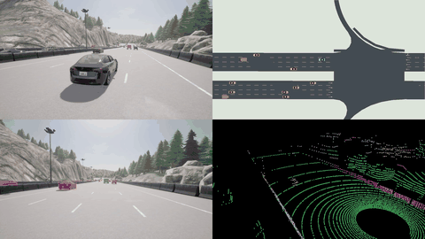
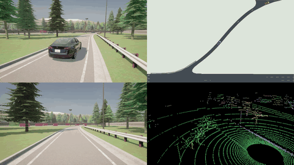
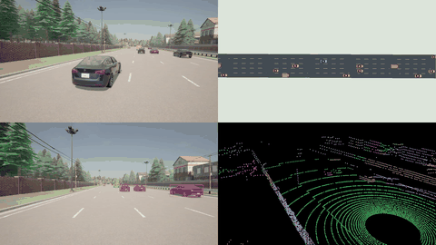
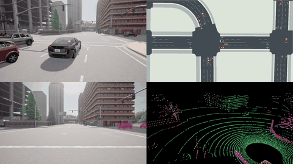
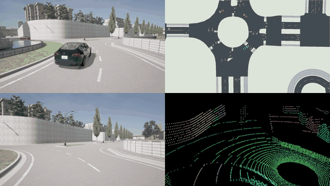
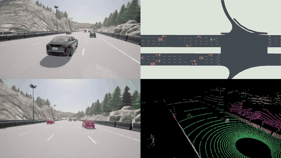

# DriveWeave — verified native v2 previews

[Verified Release](https://github.com/Ekko82/DriveWeave/releases/tag/v2.0.0)

## 高速换道

[Full video](https://github.com/Ekko82/DriveWeave/releases/download/v2.0.0/highway-carla-sumo-four-pane.mp4)

## 匝道驶入

[Full video](https://github.com/Ekko82/DriveWeave/releases/download/v2.0.0/ramp-entry-carla-sumo-four-pane.mp4)

## 匝道驶出

[Full video](https://github.com/Ekko82/DriveWeave/releases/download/v2.0.0/ramp-exit-carla-sumo-four-pane.mp4)

## 宽路口无保护左转

[Full video](https://github.com/Ekko82/DriveWeave/releases/download/v2.0.0/left-turn-carla-sumo-four-pane.mp4)

## 环岛驶入驶出

[Full video](https://github.com/Ekko82/DriveWeave/releases/download/v2.0.0/roundabout-carla-sumo-four-pane.mp4)

## 官方双向实时协同

[Full video](https://github.com/Ekko82/DriveWeave/releases/download/v2.0.0/live-highway-carla-sumo-four-pane.mp4)

All displayed SUMO GUI panes remain post-capture replay. Live acquisition is independently verified for live-highway only.
Left-turn retains one unchanged empty background lane field at an invisible connected-endpoint sample. The original strict all-lane FAIL is preserved; all-actor lane membership is false. Ego lane membership, exact source poses/times and native images remain verified.
Roundabout retains two visible ego endpoint empty lane fields and fourteen invisible background empty lane fields. All-actor and all-ego lane membership are false; the original strict FAIL remains. Exact full source poses/times and original native PNG hashes are verified; independent GUI repeat raster variation is disclosed.
